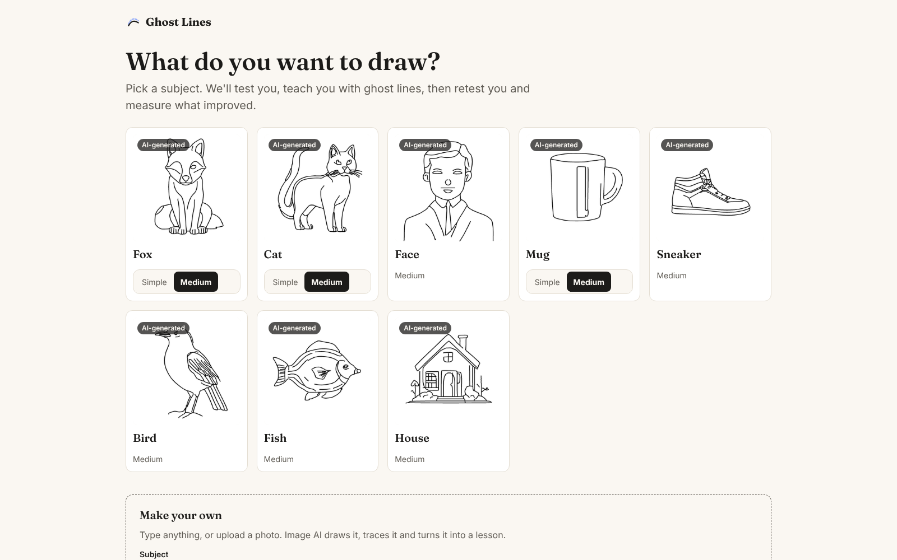

# Ghost Lines

**Ghost Lines teaches you to draw, and shows you how much you improved.**

You pick a subject and copy it on your own in 45 seconds. Ghost Lines finds your weak spots and teaches them
with faint "ghost" guide lines drawn on your canvas. The help adapts as you draw: it starts with full guide lines,
then drops to dots you connect, then to check-ins. Then it tests you again and puts the two drawings side by side,
with before and after scores measured from your strokes.

Live: **https://aarushgupta850.github.io/Bananahacks-/**



Built at Banana Hacks 2026 (theme: image AI).

## How it works

Choose subject → Reference → Test (solo, 45 s) → Weak spots → Teach (adaptive ghost lines; guided, hints,
check-in or auto mode) → Retest (solo, 45 s) → Report (measured before and after).

- The whole app runs in your browser. It is a static site on GitHub Pages.
- Each subject's line art, strokes and lesson steps are built ahead of time by a Python GPU pipeline in
  [`/server`](server), then saved in [`web/public/subjects`](web/public/subjects).
  The "How this lesson was made" panel shows that pipeline for each subject.
- The site has 8 subjects at medium (fox, cat, face, mug, sneaker, house, bird, fish), plus simple levels for
  fox, cat and mug. Where OWLv2 put a part in the wrong place, we placed it by hand
  (see [server/PACK_QA.md](server/PACK_QA.md)).
- An optional live server (`server/api.py`) can make new lessons. The app works fully without it.

**The AI pipeline that builds each lesson** (`/server`): SDXL-Lightning draws four line-art drafts, the
cleanest is thinned to 1 px lines and traced into strokes, OWLv2 finds and labels the parts, and the strokes
are ordered the way an artist draws (construction shapes, outlines, structure, details). The drawing you copy
is the chosen AI drawing itself, cleaned (page to white, ink to black). The guides and measurements use the
strokes traced from that same image. Packs built offline from a photo (`build_pack.py --photo`) are first
redrawn with a line-art detector and the MistoLine ControlNet.

**Live lessons** (optional; setup in [server/LIVE.md](server/LIVE.md)): when our GPU server is online,
"Make your own" on the subject picker builds a lesson from anything you type, or from a photo. It takes about
15 to 20 seconds on an RTX 4060 Ti.

- **Photos:** the browser turns the photo into a JPEG of at most 1536 px, so WebP and iPhone HEIC photos (in
  Safari) work. OWLv2 recognizes what the photo shows, from a list of about 100 drawable subjects ("a mug",
  "a dog", "a bicycle"), and SDXL-Lightning draws that subject fresh, exactly like a typed one. The lesson's
  "How this lesson was made" panel shows your photo and what it was recognized as. (Redrawing the photo itself
  came out as hundreds of broken strokes on real photos, so nearly every photo was refused.) If you type a name
  with the photo, that name is used. A photo OWLv2 can't name gets a hint to type what it is.
- **Every allowed prompt gets a lesson.** If no AI draft fits the 60-stroke limit, the cleanest one is
  simplified to its 60 longest lines.
- **Safety:** prompts are checked against a blocklist that also catches disguised words (leetspeak like
  "n4k3d", "p.o.r.n", explicit words inside other words), and the prompt is always wrapped in the line-art
  prompt. Uploaded photos and the chosen drawing are checked for nudity and weapons with OWLv2. Photos are
  never stored.
- **Happy accidents** (try it with `?happy=1`): when a stroke goes badly wrong during the lesson, the server
  redraws the target around what you drew (img2img on your canvas), drops the lines you already drew, and the
  lesson continues with "Nice, we've worked that into your drawing."

**The in-browser engine** (`web/src/engine/real`, plain TypeScript):

- **Stroke matching:** checks each stroke against its guide with Fréchet and Chamfer distances.
- **Adaptive guides:** moves the guides to where you're drawing with a rotation-limited Procrustes fit, and fades
  the help (Guided → Hints → Check-in) as your accuracy rises.
- **Measuring improvement:** aligns your whole drawing with the target (ICP), so size and position don't count
  against you, then measures each part's size, position, shape and tilt. Every score and percentage on screen
  comes from these measurements.

More: [project description](docs/DESCRIPTION.md), [write-up](docs/WRITEUP.md) and [demo video plan](docs/VIDEO.md).

## Run it

**Web app** (Node 20+):

```bash
cd web
npm install
npm run dev
```

Then open http://localhost:5173/Bananahacks-/. Run the tests with `npm test -- --run`.

**Server** (optional; Windows PowerShell, Python 3.13 and an NVIDIA GPU):

```powershell
python -m venv server/.venv
server\.venv\Scripts\pip install torch torchvision --index-url https://download.pytorch.org/whl/cu130
server\.venv\Scripts\pip install -r server/requirements.txt
```

torch comes first, from PyTorch's CUDA index, because the torch on PyPI is CPU-only on Windows.
To start the server, activate the venv with `server\.venv\Scripts\activate`, then run
`uvicorn api:app --app-dir server --port 8000`. Run its tests with `pytest server`.

## Who owns what

Two of us build this in parallel:

- **Jeff**: the interface (`web/src/screens`, `web/src/canvas`, `web/src/styles`, `web/src/App.tsx`).
- **Aarush**: the drawing engine (`web/src/engine/real`), the subject packs and the GPU pipeline (`/server`).
- **Shared**: `web/src/engine/types.ts`, the contract both halves build against. Changes are logged in
  [CONTRACT_CHANGES.md](CONTRACT_CHANGES.md).

The full rules are in [CLAUDE.md](CLAUDE.md), [web/CLAUDE.md](web/CLAUDE.md) and [server/CLAUDE.md](server/CLAUDE.md).

## AI tools used

- **Claude Code** (Anthropic's AI coding assistant) helped us throughout the build. Each of us used it in our
  own part of the project to plan, write and test code, and we directed and reviewed what it wrote. We also
  used it to review the drawing engine and to click through the app in a headless browser before merging.
- **Image AI models** are part of the product itself: the pack pipeline in [`/server`](server) uses
  SDXL with SDXL-Lightning to draw the line art (and, with img2img, for Happy accidents), a line-art
  detector and the MistoLine ControlNet for photo packs built offline, and OWLv2 to find each drawing's
  parts, to recognize what a live photo shows, and to check pictures for nudity and weapons. They are listed with their licenses in
  [CREDITS.md](CREDITS.md).

## Credits

Every model, library, dataset and font we use is listed with its license in [CREDITS.md](CREDITS.md).
